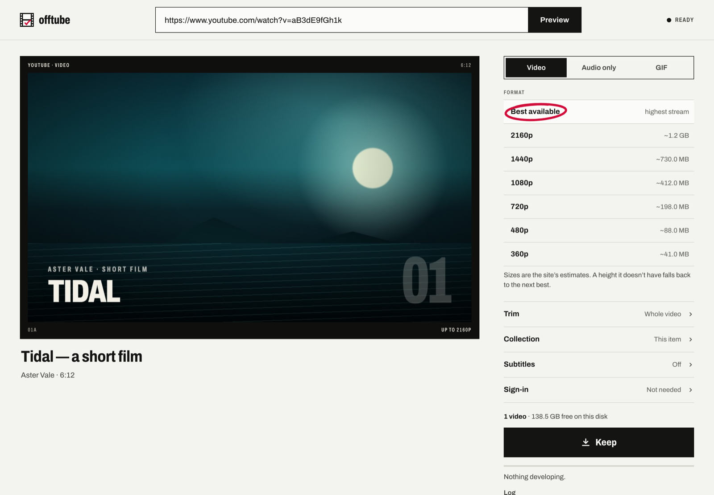
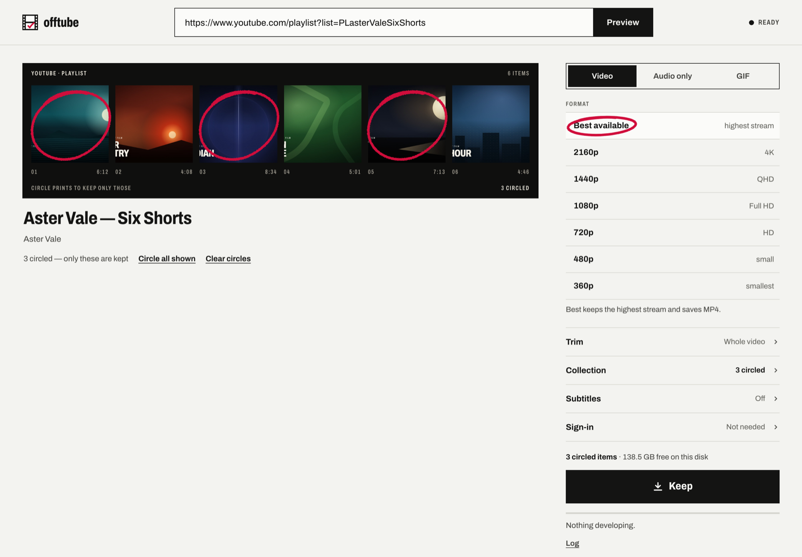

<div align="center">
  
  <h1>offtube</h1>
  <p><strong>Find it online. Keep it offline.</strong></p>
  <p>A local home for videos, music, photos, and the moments worth saving.<br>Paste a link, choose what to keep, and get the file on your own machine.</p>
  <p><a href="#get-started">Get started</a> · <a href="extension/README.md">Chrome extension</a> · <a href="docs/guide.md">User guide</a> · <a href="docs/api.md">API</a></p>
</div>

<picture>
  <source media="(prefers-color-scheme: dark)" srcset="docs/assets/desk-dark.png">
  
</picture>

<sub>The real web desk, in light or dark to match your theme. Screenshots use fictional demo media; see [asset notes](docs/assets/README.md).</sub>

## A keeper, not another streaming service

offtube puts **yt-dlp**, **gallery-dl**, and **FFmpeg** behind one paste box.
Keep a video, extract its audio, save the originals from a photo post, or
pick a few things from a whole playlist or board. Use the web desk or keep
straight from your browser with the Chrome extension.

No offtube account. No cloud backend. Files land in `downloads/` beside the
app. The server and extension run on your computer; the source sites still
receive the requests needed to inspect and fetch their media.

| Keep what you mean | Without losing the details |
| --- | --- |
| **Video and audio** | Best available, 2160p–360p choices, or MP3/M4A audio. |
| **Photos and galleries** | Original files from posts, pins, albums, and boards. |
| **Just a moment** | Trim a video, or make a silent GIF with size, frame-rate, and loop controls. |
| **A few from a collection** | Circle the previews you want, keep everything, or enter a range like `1-5,7`. |
| **A small working queue** | Up to five active jobs, two running at once; progress, cancel, retry, and a transfer log. |
| **Your own library** | A searchable contact sheet, media filters, previews, Save, and Delete. Files survive restarts; job history does not. |

The interface borrows from a photographer's contact sheet: black film on
neutral paper, a crimson circle for a choice, a tick for a kept file, and a
print that develops as it saves. Full controls stay folded until needed.

## Get started

### 1. Install the tools

For native use, have **Python 3.10+**, **FFmpeg** (including `ffprobe`), and
**Deno 2.x or a supported Node.js runtime** on your `PATH`. offtube's Node
check requires **23.5 or later**. There is no frontend build or npm install
for normal use.

On macOS with Homebrew:

```sh
brew install python ffmpeg deno
```

[Linux, Windows, and manual setup →](docs/guide.md#native-installation)
Prefer a bundled runtime? [Use Docker instead →](docs/guide.md#docker)

### 2. Start offtube

```sh
git clone https://github.com/0xuser64bit/offtube.git
cd offtube
./run.sh
```

On Windows, run `run.bat` instead of `./run.sh`. The launcher creates a
project-local `.venv` and installs the pinned Python dependencies if they
are missing. Run `./run.sh --upgrade` (or `run.bat --upgrade`) to refresh
the pins and move `yt-dlp` and `gallery-dl` to their latest releases when
a site stops working. Keep the terminal open while you use offtube.

### 3. Keep something

Open **[127.0.0.1:8000](http://127.0.0.1:8000)**, paste a supported media
link, choose **Preview**, then **Keep**. Finished files appear under
**Kept** and in the project's `downloads/` folder. Press **Ctrl+C** in the
server terminal to stop.

For sign-in-only media, use [your own browser session or a cookies
export](docs/guide.md#sign-in-and-cookies). offtube cannot bypass DRM,
paywalls, or an account's access restrictions.

## Keep from the tab you're on

Load the included `extension/` folder in Chrome 116+ with **Developer mode
→ Load unpacked** at `chrome://extensions`. The local server must still be
running.

- **Toolbar popup:** the current tab, its preview, and a quick Keep.
- **Side panel:** follows tabs and stays open, with trim, collections,
  sign-in, the session queue, and the library.
- **Right-click:** Keep a link or the current page without opening the desk.
- **Keyboard:** `Alt+Shift+O` opens the side panel.

[Extension setup, permissions, and sign-in behavior →](extension/README.md)

## Pick the prints, not the whole pile



Circle individual previews or use **Whole collection** and a range. For
YouTube, paste a playlist's own `/playlist?list=…` URL to inspect it as a
collection; a watch-page link remains a single-video preview.

[Collections, GIFs, subtitles, and everyday workflows →](docs/guide.md#keeping-media)

## What links work?

offtube checks the installed engines' **dedicated extractors**, rather than
maintaining a separate site list. Examples include:

| Media | Some of the supported sources |
| --- | --- |
| Video and audio | YouTube, TikTok, Instagram, X, Reddit, Facebook, Vimeo, Twitch, Bilibili, SoundCloud, Bandcamp, Mixcloud |
| Photos, posts, and galleries | Pinterest, Instagram, X, Reddit, Tumblr, Bluesky, Flickr, Imgur, DeviantArt, ArtStation, pixiv |

An extractor match is not a promise that every post will work: sites change,
some links require sign-in, and deleted or restricted media stays
unavailable. Generic page scraping, direct-file catch-alls, IP/LAN links,
and known DRM services are refused. YouTube channel, home, and search pages
are also refused to avoid unexpectedly huge downloads.

Use `GET /api/source?url=…` to check a link without contacting its site.
See the [source and inspection API](docs/api.md#check-and-inspect-a-link) for
examples.

## Local means your machine, not a security boundary

**Use offtube only on a trusted, single-user machine.** There is no API
authentication: other local programs, other accounts on the computer, and
installed browser extensions can start jobs and read or delete kept files.
Do not expose the port to your LAN or the internet. Keep Docker's published
port bound to `127.0.0.1`.

Browser-origin checks block foreign web pages from using the API, but do
not replace authentication. Extractor matching is not a network sandbox.
Read the [trust boundary](ARCHITECTURE.md#trust-boundary) before changing
where the server listens. Only keep content you own or are authorized to
save.

## Go deeper

| I want to… | Start here |
| --- | --- |
| Install, use cookies, run Docker or a background service, fix a failure | [User guide](docs/guide.md) |
| Keep from Chrome | [Extension guide](extension/README.md) |
| Script downloads or integrate another client | [Local API](docs/api.md) |
| Change the code or run the checks | [Contributing](CONTRIBUTING.md) |
| Understand the workers, queue, and security limits | [Architecture](ARCHITECTURE.md) |
| Understand the product and its visual language | [Product and design](DESIGN.md) |

Built with [yt-dlp](https://github.com/yt-dlp/yt-dlp),
[gallery-dl](https://github.com/mikf/gallery-dl), and
[FFmpeg](https://ffmpeg.org/). Backend: Python's standard library, no web
framework. Frontend: plain HTML, CSS, and JavaScript, with self-hosted
[Archivo](web/fonts/OFL-Archivo.txt).

[MIT licensed](LICENSE).
