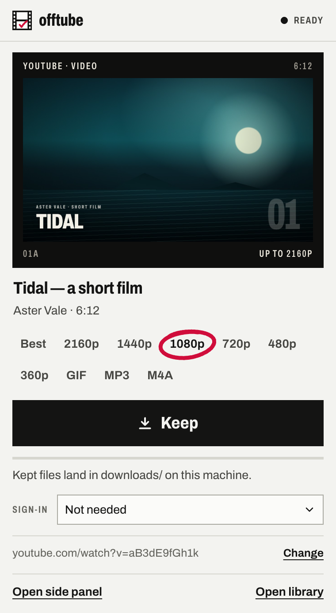
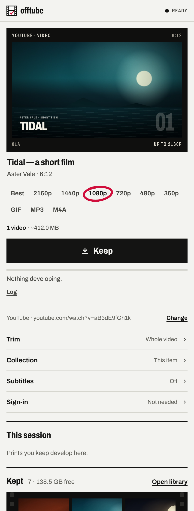

# Keep from Chrome

[Home](../README.md) · [User guide](../docs/guide.md) ·
[API](../docs/api.md) · [Contributing](../CONTRIBUTING.md)

The offtube extension is a thin client for the local server: keep from the
tab you're on, open a persistent side panel, or right-click a link. It
does not download on its own. Files are written by the server to the same
`downloads/` folder used by the web desk.

## Install

1. Start the local server with `./run.sh` or `run.bat`. Check that
   `http://127.0.0.1:8000` opens. [Server setup →](../docs/guide.md#native-installation)
2. In **Chrome 116 or later**, open `chrome://extensions` and turn on
   **Developer mode**.
3. Choose **Load unpacked** and select this repository's `extension/`
   folder, not the repository root.
4. Pin offtube in Chrome's toolbar if you want one-click access.
5. Open a supported media page, click offtube, and choose **Keep**.

The extension is distributed here as source, not as a Chrome Web Store
installation. After changing or updating its files, click **Reload** on
its entry at `chrome://extensions`.

## Choose your surface

| Surface | Best for | Behavior |
| --- | --- | --- |
| **Toolbar popup** | A quick keep | Prefills a supported active tab, inspects it, and offers output choices. Change the link manually if needed. Closes when you click away. |
| **Side panel** | Staying with a workflow | Follows tabs, exposes trim/collection/sign-in controls, and keeps the session and library visible. Open it from the popup or with `Alt+Shift+O`. |
| **Right-click menu** | Keeping without opening the desk | Keep a link, or keep the current page from a page/image/video/audio context. Uses saved format and sign-in preferences. |

<table>
  <tr><th>Quick keep</th><th>Full controls</th></tr>
  <tr>
    <td valign="top"></td>
    <td valign="top"></td>
  </tr>
</table>

Actual extension pages with fictional demo content; [asset notes](../docs/assets/README.md).

The right-click action sends a **page or link URL**, not an image/video
element's `blob:` or CDN source. The engines need the original supported
site URL. The badge shows `…` while a right-click keep is running, `↓`
once its files are kept, and `!` if it fails or the link is unsupported.

If the shortcut does not work, check `chrome://extensions/shortcuts` and
assign or confirm it there. **Open side panel** closes the popup so only
one of those surfaces is active at a time.

## Formats and sign-in

Video quality choices, audio extraction, and GIF settings use the same API
as the desk. Image galleries keep originals and hide video-only controls;
audio sources default to audio. GIF preferences also apply to right-click
keeps. Collections can produce one GIF per video, skipping images.

**Sign-in → Browser** reads the browser profile on the machine/account
running the **native server**, not cookies obtained by this extension.
Docker cannot read your host browser. A sign-in error in the popup can
offer **Use my browser's sign-in**.

**Sign-in → Cookies file** belongs in the side panel or web desk. Cookie
contents are not saved in extension storage. With that mode selected,
right-click and shortcut flows open the side panel so it can supply the
export. Upload or paste it there when needed.

[Cookie setup, retention, and troubleshooting →](../docs/guide.md#sign-in-and-cookies)

## Server address and permissions

The default server is `http://127.0.0.1:8000`. Change **Server** in the
side panel if you use another port or IPv6. Only HTTP loopback URLs
(`127.0.0.1`, `localhost`, `[::1]`) are accepted; this is not a remote-server
client.

| Permission | Why it is used |
| --- | --- |
| `tabs` | Reads the active tab URL/title and follows tab changes. |
| `storage` | Saves local preferences and pending selections, not cookie contents. |
| `sidePanel` | Opens Chrome's persistent side panel. |
| `contextMenus` | Adds the right-click keep actions. |
| `alarms` | Wakes the service worker to report a right-click keep that finishes after the menu has closed. |
| Loopback `host_permissions` | Calls the local server. No `<all_urls>` permission or source-site content scripts. |

The server is the authority on supported URLs (`GET /api/source`); there
is no separate extractor/site list in the extension. Its browser-origin
protections are not authentication. Any installed extension with the
necessary access may reach the local API; see the
[trust boundary](../ARCHITECTURE.md#trust-boundary).

## Implementation notes

- [`shared.js`](shared.js) holds API, settings, and UI helpers;
  [`ui.css`](ui.css) shares the contact-sheet visual language.
- The MV3 [`background.js`](background.js) worker holds no durable job
  state: right-click jobs are tracked in session storage and an alarm
  wakes the worker to report a late outcome. Popup and side-panel pages
  poll the server directly.
- Opening a side panel must happen **before the listener's first await**
  while Chrome still recognizes the user gesture. Context-menu IDs encode
  whether cookies-file mode needs the panel; rebuild them when it changes.
- Scripts and fonts are local, with no inline scripts. Icons derive from
  the film-strip mark through [`tools/gen_icons.py`](../tools/gen_icons.py).

For tests and known browser-coverage limits, see
[Contributing](../CONTRIBUTING.md#browser-and-accessibility-checks).
